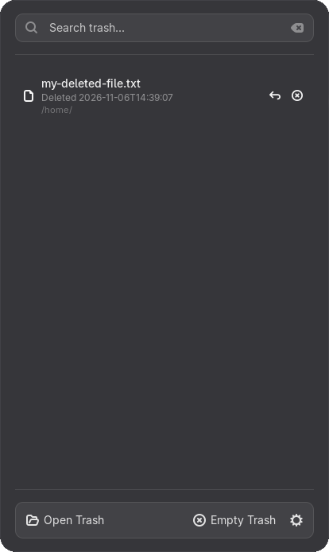

# Gnome Trash


A professional GNOME Shell extension to manage the trash items in [GNOME](https://www.gnome.org/). It lists the files in the trash bin in the panel menu and lets you open, restore, or permanently delete them, as well as empty the trash.

> **Note:** This extension only shows items under the home trash folder (`~/.local/share/Trash`).



## 🌟 Features

- **Panel Integration**: A trash icon in the top bar that reflects whether the trash is full or empty.
- **Categorized List**: Browse every trashed file from the panel menu.
- **Searchable**: Quickly find trashed items using the built-in search box.
- **Item Actions**: Restore or permanently delete individual files.
- **Empty Trash**: Empty the whole trash from a single action, behind a confirmation dialog.
- **Open Trash**: Open the system trash location in your default file manager.
- **Configurable**: Choose the sort order, the default activation behavior, and whether the button is hidden when the trash is empty.
- **Modern GNOME Compatibility**: Fully compliant with GNOME 45+ review guidelines, including all-asynchronous I/O operations for zero UI blocking.

## ⚙️ Configuration & Preferences

You can customize Gnome Trash using the extension's preferences window.

| Setting                 | Description                                                           | Default     |
| :---------------------- | :-------------------------------------------------------------------- | :---------- |
| **Sort trash by**       | Order items by `File name` or `Delete time`.                          | `File name` |
| **Activation behavior** | What happens when an item is clicked: `Open`, `Restore`, or `Delete`. | `Restore`   |
| **Hide button**         | Hide the panel button when the trash is empty.                        | `false`     |

### Logging

The log level can be tuned with the `log-level` gsettings key (`0` off … `4` debug).

## Installation

### Option 1: Official GNOME Extensions (Recommended)

Install **Gnome Trash** from the [Official GNOME Extensions](https://extensions.gnome.org/extension/4410/gnome-trash/) page.

### Option 2: From Source Code (For testing & latest features)

**Prerequisites:**

- `git`, `make`, `nodejs` & `npm` (the build uses the TypeScript compiler; `npx` is used when `tsc` is not installed)

**Build Commands:**

1. **Clone and Build (Zip only):**

    ```bash
    make build
    ```

    _Compiles the source and packs the extension into a `.zip` file._

2. **Build and Install:**

    ```bash
    make install
    ```

3. **Enable and Listen:**

    ```bash
    make enable
    make listen
    ```

4. **Restart GNOME Shell:**
    - **X11**: Press `Alt` + `F2`, type `r`, and press `Enter`.
    - **Wayland**: You must log out and log back in.

    Alternatively, run the automated script which detects your session type:

    ```bash
    make restart-shell
    ```

**For Developers:**

To automate the build-install-restart loop, run:

```bash
make test
```

_On Wayland, `make test` will log you out to apply the changes._

You can test the extension in a nested Wayland session with:

```bash
make test_wayland
```

## 🛠️ Development Commands

The project uses a standard `Makefile` to manage the build lifecycle:

- `make build`: Default target. Compiles and packs the extension into a ZIP.
- `make install`: Compiles, packs, and installs to the system extensions directory.
- `make clean`: Removes the `dist` build directory and ZIP artifacts.
- `make update-translations`: Extracts new strings and updates all `.po` files.
- `make test`: Full cycle: Install, Enable, and attempt to Refresh the Shell.
- `make lint`: Runs ESLint over the codebase.
- `make format`: Runs Prettier and rewrites files in place.
- `make check`: Runs the type check, ESLint and a Prettier check (same as CI).

### Linting & Formatting

The project uses [ESLint](https://eslint.org/) (with
[typescript-eslint](https://typescript-eslint.io/)) for linting and
[Prettier](https://prettier.io/) for formatting. Tooling lives in `node_modules`,
so install it once:

```bash
make deps      # or: npm install
```

Then use:

```bash
npm run typecheck     # tsc --noEmit
npm run lint          # report problems
npm run lint:fix      # fix what ESLint can fix automatically
npm run format        # rewrite files with Prettier
npm run format:check  # verify formatting without writing
npm run check         # all of the above, as run in CI
```

GitHub Actions runs `make check` (type check, lint, format check) on every push to
`main` and on pull requests.

## 🌍 Contributing & Translations

Contributions are extremely welcome! If you find a bug or have a feature request, please open an issue.

### Adding a new translation

1. Run `make update-translations` to refresh the template.
2. Create or edit the `.po` file in the `po/` directory using Poedit or `msginit`.

## 📜 License

This project is licensed under the GPL-3.0 License. See the [LICENSE](LICENSE) file for more details.
